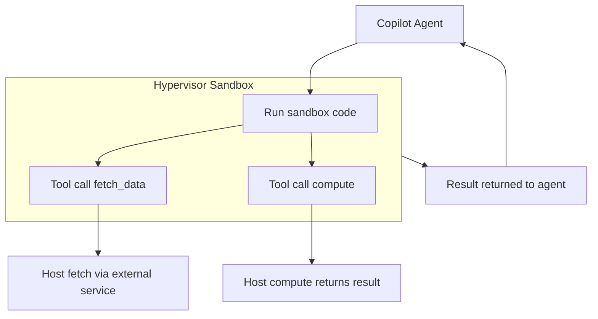

<div align="center">
    <h1>Hyperlight</h1>
    
    <p><strong>Hyperlight is a lightweight Virtual Machine Manager (VMM) designed to be embedded within applications. It enables safe execution of untrusted code within <i>micro virtual machines</i> with very low latency and minimal overhead.</strong> <br> We are a <a href="https://cncf.io/">Cloud Native Computing Foundation</a> sandbox project. </p>
</div>

# Hyperlight Sandbox

A multi-backend sandboxing framework for running untrusted code with controlled host capabilities. Built on [Hyperlight](https://github.com/hyperlight-dev/hyperlight).

Supported backends:

- [Wasm Component Sandbox](#wasm-component-sandbox) (Python/Javascript or provide your own)
- [HyperlightJS Sandbox](#hyperlightjs-sandbox)
- [Unikraft Sandbox](#unikraft-sandbox) (full CPython, with numpy/pandas/scipy/scikit-learn)

## Overview

hyperlight-sandbox provides a unified API across multiple isolation backends. All backends share a common capability model.  A python, .NET, and rust SDK is provided.

- **Secure code execution** -- Run untrusted code in hardware isolated sandboxes (KVM, MSHV, Hyper-v)
- **Host tool dispatch** -- Register callables as tools; guest code invokes them by name with schema-validated arguments
- **Capability-based file access** -- Read-only `/input` directory, writable `/output` directory, strict path isolation
- **Snapshot / restore** -- Capture and rewind sandbox runtime state making it re-useable
- **Network allow listing** -- Network traffic is off by default; allow specific domains and HTTP verbs with `allow_domain()`

For a more in depth walkthrough, see the overview slide deck in `docs/end-user-overview-slides.md` (or run `just slides` to view in the browser).
### Use Cases

- **File Processing**: Process provided files and return a summarized report
- **Code Mode**: Let an agent write a script that calls your tools directly, reducing token usage
- **Sandboxed Execution as a library**: drop into an existing app or library to provide plugins 
- **Agent Skills** combine scripts into multi-step workflows that run in isolation (future work)

#### Agent Use Case



## Quick Start

Requires [KVM](https://help.ubuntu.com/community/KVM/Installation), [MSHV](https://github.com/rust-vmm/mshv) or [Hyper-v](https://learn.microsoft.com/en-us/windows-server/virtualization/hyper-v/get-started/Install-Hyper-V?tabs=powershell&pivots=windows-server)

Python SDK:

The Python SDK and packaged Wasm guest wheels support CPython 3.10 through 3.15.

```shell
uv pip install "hyperlight-sandbox[wasm,python_guest]"
```

And to use it:

```python
from hyperlight_sandbox import Sandbox

sandbox = Sandbox(backend="wasm", module="python_guest.path")
sandbox.register_tool("add", lambda a=0, b=0: a + b)
sandbox.allow_domain("https://httpbin.org")

result = sandbox.run("""
total = call_tool('add', a=3, b=4)
resp = http_get('https://httpbin.org/get')
print(f"3 + 4 = {total}, HTTP status: {resp['status']}")
""")
print(result.stdout)
```

.NET SDK:

```shell
dotnet add package Hyperlight.HyperlightSandbox.Api
dotnet add package Hyperlight.HyperlightSandbox.Guest.Python
```

```csharp
using HyperlightSandbox.Api;
using HyperlightSandbox.Guest.Python;

using var sandbox = new SandboxBuilder()
    .WithPythonModule()
    .Build();

sandbox.RegisterTool<MathArgs, double>("add", args => args.a + args.b);
sandbox.AllowDomain("https://httpbin.org");

var result = sandbox.Run("""
    total = call_tool("add", a=3, b=4)
    resp = http_get("https://httpbin.org/get")
    print(f"3 + 4 = {total}, HTTP status: {resp['status']}")
    """);
Console.WriteLine(result.Stdout);

record MathArgs(double a, double b);
```

For full .NET SDK documentation, see [src/sdk/dotnet/README.md](src/sdk/dotnet/README.md).

## Sandbox Backends

### Wasm Component Sandbox

Loads a Wasm component via [hyperlight-wasm](https://github.com/hyperlight-dev/hyperlight-wasm) and exposes the full capability surface through WIT-generated bindings. Supports the packaged Python guest and JavaScript guest. Use this for general-purpose workloads that need tools, file I/O, networking, and snapshots.

Build your own using the provided [WIT interface](src/wasm_sandbox/wit/hyperlight-sandbox.wit). See the [python](./src/wasm_sandbox/guests/python/) and [javascript](./src/wasm_sandbox/guests/javascript/) guests for examples.

```rust
use hyperlight_sandbox::{Sandbox, ToolRegistry};
use hyperlight_wasm_sandbox::Wasm;
use serde::Deserialize;

#[derive(Deserialize)]
struct MathArgs { a: f64, b: f64 }

fn main() {
    let mut tools = ToolRegistry::new();
    tools.register_typed::<MathArgs, _>("add", |args| {
        Ok(serde_json::json!(args.a + args.b))
    });

    let mut sandbox = Sandbox::builder()
        .guest(Wasm)
        .module_path("guests/python/python-sandbox.aot")
        .with_tools(tools)
        .build()
        .expect("failed to create sandbox");

    let result = sandbox.run(r#"
result = call_tool('add', a=3, b=4)
print(f"3 + 4 = {result}")
"#).unwrap();
    print!("{}", result.stdout);

    // Snapshot and restore interpreter state
    let snap = sandbox.snapshot().unwrap();
    sandbox.run("print('hello world')").unwrap();
    sandbox.restore(&snap).unwrap();
    //fresh env
    sandbox.run("print('hello world 2!')").unwrap();
}
```

See [examples](./src/wasm_sandbox/examples/) for file I/O and network demos.

### HyperlightJS Sandbox

Runs JavaScript directly on the [HyperlightJS](https://github.com/hyperlight-dev/hyperlight-js) runtime without going through the Wasm component model. Injects `call_tool`, `read_file`, `write_file`, and `fetch` as globals. Supports snapshots, file I/O, and network allowlists. A simpler runtime path when the workload is JavaScript-only and need a smaller footprint.

```rust
use hyperlight_javascript_sandbox::HyperlightJs;
use hyperlight_sandbox::{Sandbox, ToolRegistry};
use serde::Deserialize;

#[derive(Deserialize)]
struct MathArgs { a: f64, b: f64 }

fn main() {
    let mut tools = ToolRegistry::new();
    tools.register_typed::<MathArgs, _>("add", |args| {
        Ok(serde_json::json!(args.a + args.b))
    });

    let mut sandbox = Sandbox::builder()
        .guest(HyperlightJs)
        .with_tools(tools)
        .build()
        .expect("failed to create sandbox");

    let result = sandbox.run(r#"
const sum = call_tool('add', { a: 10, b: 20 });
console.log('10 + 20 = ' + sum);
"#).unwrap();
    print!("{}", result.stdout);

    // Snapshot and restore
    let snap = sandbox.snapshot().unwrap();
    sandbox.run("globalThis.counter = 100;").unwrap();
    sandbox.restore(&snap).unwrap();
    // fresh env counter is undefined again!
}
```

See [examples](./src/javascript_sandbox/examples/) for file I/O and network demos.

### Unikraft Sandbox

Runs full CPython 3.12 in a [Unikraft](https://unikraft.org) unikernel inside a Hyperlight micro-VM, via [hyperlight-unikraft](https://github.com/hyperlight-dev/hyperlight-unikraft). Use it when guest code needs native extensions the Wasm guest cannot load: the published `agent` image ships numpy, pandas, scipy, scikit-learn, matplotlib and more. Guest code gets the same globals as the Wasm Python guest (`call_tool`, `http_get`, `http_post`), `/input` and `/output`, and snapshot/restore of the whole micro-VM.

The module path is a rootfs image (initrd CPIO). `cached_rootfs("agent")` finds the one the [`hluk`](https://github.com/hyperlight-dev/hyperlight-unikraft) CLI caches (`just unikraft pull-images` pulls `python` and `agent`).

```rust
use hyperlight_sandbox::{SandboxBuilder, ToolRegistry};
use hyperlight_unikraft_sandbox::{Unikraft, cached_rootfs};

fn main() -> anyhow::Result<()> {
    let mut tools = ToolRegistry::new();
    tools.register_unvalidated("fetch_data", |_| Ok(serde_json::json!([1, 2, 3, 4])));

    let mut sandbox = SandboxBuilder::new()
        .module_path(cached_rootfs("agent")?.display().to_string())
        .with_tools(tools)
        .guest(Unikraft::new())
        .build()?;

    let result = sandbox.run(r#"
import numpy as np
print(np.mean(call_tool('fetch_data')))
"#)?;
    print!("{}", result.stdout);
    Ok(())
}
```

From Python: `Sandbox(backend="unikraft")` (the `agent` image by default; `module="python"` or `module_path=...` for another), installed with `hyperlight-sandbox[unikraft]`.

How it differs from the other backends:

- Only the `python`, `python-shell` and `agent` images are supported, and they must be the hyperlight-unikraft release the crate is built against (`IMAGE_RELEASE`).
- Guest memory is one size, the image's tested default (1.5 GiB for `agent`); set it with `Unikraft::scratch_mb` (`scratch_size="2Gi"` in Python, `WithScratchSize("2Gi")` in .NET). Heap and stack sizes do not apply: the Python and .NET SDKs refuse them, and the Rust builder's are ignored.
- `/input` and `/output` are host directories mounted into the guest when it boots, so the guest writes `/output` directly. `/output` is read-write if its permissions allow creating and writing files, else read-only; it cannot be write-only. The filesystem limits are checked after each run: a run that exceeded them, or that left a symbolic or hard link, a special file, or a tree deeper than 64 levels or over 100,000 entries in `/output`, fails and its output is removed, but the bytes did reach the host disk first, so put the output directory on quota-controlled storage. Before each run, and after a failed check, `/output` is cleared of every file and link and of the directories the guest made; directories it had when the sandbox was built are kept, emptied. (The other backends keep every directory and remove files only.) The guest keeps the directories it booted with; if either is replaced on the host after the sandbox is built, the re-boot an allowlist change makes (with `native_network`) fails until the original is put back.
- `http_get` / `http_post` go through the host and the `allow_domain` allowlist, as in the Wasm guest. Guest sockets (`requests`, `urllib`) are off unless `Unikraft::native_network(true)` (`native_network=True`), and are then allowed to the `allow_domain` hosts by name only: scheme, port, path and method filters apply to `http_get` / `http_post` only. Those names are resolved when the allowlist changes; one that does not resolve is left out (the next run's stderr says so).
- One host call carries at most 64 KiB; larger code, tool arguments and results, and HTTP bodies are chunked transparently. The host holds at most 64 MiB of them unread at a time, so a single tool result or HTTP response can be up to that size.
- Exit statuses are those a CPython process exits with, 0 to 255 (`sys.exit(-1)` is 255, `sys.exit(256)` is 0), so -1 always means the guest itself failed.
- Guest code can run threads and child processes (`subprocess`, and shell pipelines in the `agent` and `python-shell` images, which have a `/bin/sh`). Output written straight to the file descriptors (by child processes, C extensions, or the guest kernel, whose messages are standard error) reaches the run's `stdout` and `stderr` too.
- hyperlight-unikraft's guest limits apply: a single vCPU and no AVX.

See [examples](./src/unikraft_sandbox/examples/) and [the Python example](./src/sdk/python/core/examples/unikraft_basics.py).

### Writable filesystem limits

Writable output is bounded by default to 5 MiB per file, 20 MiB of cumulative
logical file size, and 20 files per sandbox. Logical size includes sparse
holes, so a guest cannot bypass the limit by writing a small buffer at a very
large offset. Hosts can configure larger limits or explicitly opt out through
their SDK.

These library limits do not measure physical blocks, metadata, compression, or
deduplication. Deployments running hostile or multi-tenant workloads should
also place output directories on isolated, quota-controlled storage and prevent
other host processes from modifying them during guest execution.

Rust hosts can override the defaults on the builder:

```rust
use hyperlight_sandbox::{FilesystemLimits, SandboxBuilder};
use hyperlight_wasm_sandbox::Wasm;

let limits = FilesystemLimits::new(
    128 * 1024 * 1024,
    512 * 1024 * 1024,
    2_048,
)?;

let sandbox = SandboxBuilder::new()
    .filesystem_limits(limits)
    .module_path("guest.aot")
    .temp_output()
    .guest(Wasm)
    .build()?;
```

Use `FilesystemLimits::unlimited()` only when the host provides equivalent
resource controls and intentionally accepts unbounded logical output.

## Building

Tool requirements:

- just
- uv
- npm

```bash
# Build everything (Rust backends, Wasm guests, Python SDK)
just build

# Run the example suite
just examples
```

Other useful commands:

```bash
just build         # Build all Rust backends, Wasm guests, and Python SDK
just test              # Run full test suite (Rust + Python)
just lint              # Lint Rust and Python code
just fmt               # Format all code
```

## Join our Community

Please review the [CONTRIBUTING.md](./CONTRIBUTING.md) file for more information on how to contribute to
Hyperlight.

This project holds fortnightly community meetings to discuss the project's progress, roadmap, and any other topics of interest. The meetings are open to everyone, and we encourage you to join us.

- **When**: Every other Wednesday 09:00 (PST/PDT) [Convert to your local time](https://dateful.com/convert/pst-pdt-pacific-time?t=09)
- **Where**: Zoom! - Agenda and information on how to join can be found in the [Hyperlight Community Meeting Notes](https://hackmd.io/blCrncfOSEuqSbRVT9KYkg#Agenda). Please log into hackmd to edit!

## Chat with us on the CNCF Slack

The Hyperlight project Slack is hosted in the CNCF Slack #hyperlight. To join the Slack, [join the CNCF Slack](https://www.cncf.io/membership-faq/#how-do-i-join-cncfs-slack), and join the #hyperlight channel.

## More Information

For more information, please refer to the [docs directory](./docs/) and the [end-user overview slides](./docs/end-user-overview-slides.md).

## Code of Conduct

See the [CNCF Code of Conduct](https://github.com/cncf/foundation/blob/main/code-of-conduct.md).

[wsl2]: https://docs.microsoft.com/en-us/windows/wsl/install

[kvm]: https://help.ubuntu.com/community/KVM/Installation

[whp]: https://devblogs.microsoft.com/visualstudio/hyper-v-android-emulator-support/#1-enable-hyper-v-and-the-windows-hypervisor-platform
